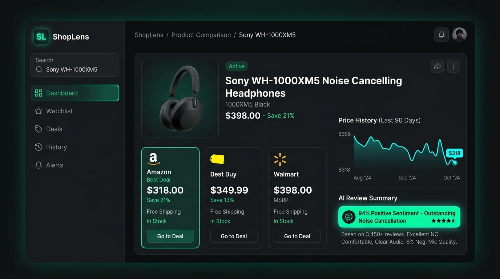

<div align="center">

# 🛍️ ShopLens AI — Multi-Store Price Comparison Engine
### *Intelligent Deal Discovery, Price Normalization & Review Sentiment Consensus*

[](https://nextjs.org/)
[](https://www.typescriptlang.org/)
[](https://python.org/)
[](https://tailwindcss.com/)
[](./LICENSE)

<br />

<p align="center">
  ShopLens is an AI-powered e-commerce intelligence platform that helps shoppers find the best real-time deals across major retailers. Simply paste a product URL or search term to normalize pricing across Amazon, Best Buy, and Walmart, track 90-day price trends, and read synthesized AI review summaries.
</p>

[**Explore Features**](#-key-features) • [**Architecture**](#-system-architecture) • [**Setup Guide**](#-getting-started) • [**Report Bug**](https://github.com/Ahmad-Haassan/shoplens/issues)

<br />



</div>

---

## 🌟 Key Features

### 1. 🔍 Cross-Platform Price Normalization
* **Real-Time Retailer Scrapers**: Concurrently fetches pricing, availability, and shipping costs across Amazon, Best Buy, Walmart, and specialty retailers.
* **Smart Matching Algorithm**: Normalizes varying manufacturer model names, UPCs, and storage/color variants to ensure direct, accurate comparisons.
* **Instant Savings Highlighting**: Flags the lowest verified price, calculates savings percentage, and filters out unreliable third-party markup prices.

### 2. 🧠 AI-Generated Review Consensus
* **Sentiment Synthesis**: Ingests thousands of verified customer reviews and synthesizes them into actionable sentiment scores (e.g., *"94% Positive Sentiment - Outstanding Noise Cancellation"*).
* **Consensus Extraction**: Highlights top-reported pros and cons (battery life, build quality, comfort) to eliminate review fatigue.

### 3. 📈 Historical Price Tracking
* **90-Day Trend Graphs**: Visualizes historical pricing fluctuations so buyers can determine whether current discounts are genuine deals or regular prices.
* **Price Drop Alerts**: Configurable alerts for target price points.

---

## 🏗️ System Architecture

```text
[ User Search / Product URL ]
             │
             ▼
[ Next.js Edge Gateway ]
             │
    ┌────────┴────────┐
    ▼                 ▼
[ FastScrape Service ] [ AI Sentiment Engine ]
(Amazon, Best Buy, etc.) (Review Aggregation)
    │                 │
    └────────┬────────┘
             ▼
[ Normalized Product State & Price Matrix ]
             │
             ▼
[ Modern Dark UI & Interactive Analytics Dashboard ]
```

---

## 🛠️ Tech Stack

* **Frontend**: Next.js (App Router), React, TypeScript, Tailwind CSS
* **Scraping & Data Extraction**: Python, BeautifulSoup4 / Playwright
* **AI & NLP Analysis**: Contextual Review Summarization via LLM APIs
* **Visuals & Charts**: Lucide Icons, Canvas/SVG sparklines

---

## 🚀 Getting Started

### 1. Clone the Repository
```bash
git clone https://github.com/Ahmad-Haassan/shoplens.git
cd shoplens
```

### 2. Install Dependencies
```bash
npm install
```

### 3. Configure Environment Variables
Create a `.env.local` file:
```bash
NEXT_PUBLIC_APP_URL="http://localhost:3000"
AI_ANALYSIS_KEY="your_ai_api_key"
SCRAPER_SERVICE_URL="http://localhost:8000"
```

### 4. Run Development Server
```bash
npm run dev
```
Open [http://localhost:3000](http://localhost:3000) to view the platform locally.

---

## 📬 Connect & Author

- **Developer**: Ahmad Hassan
- **GitHub**: [@Ahmad-Haassan](https://github.com/Ahmad-Haassan)
- **Email**: [ahmad.hassan.dev@gmail.com](mailto:ahmad.hassan.dev@gmail.com)

---

## 📄 License

This project is licensed under the [MIT License](./LICENSE).
