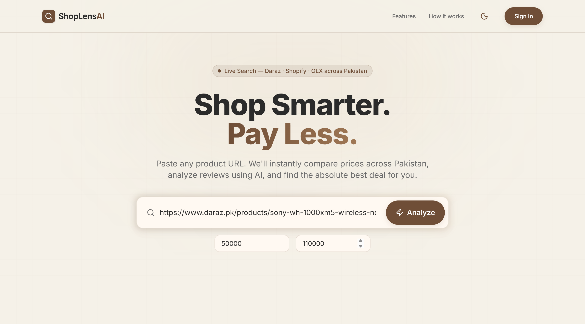
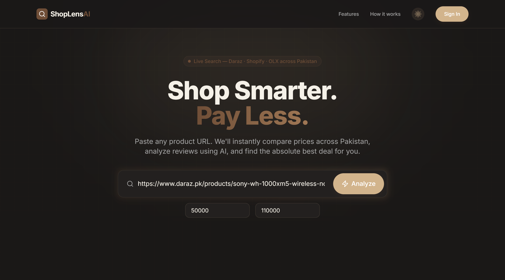

<div align="center">

# 🛍️ ShopLens AI — Multi-Store Price Comparison Engine
### *Intelligent Deal Discovery, Price Normalization & Review Sentiment Consensus*

[](https://shoplens-6st8.vercel.app/)
[](https://nextjs.org/)
[](https://react.dev/)
[](https://www.typescriptlang.org/)
[](https://tailwindcss.com/)
[](./LICENSE)

<br />

<p align="center">
  <b>ShopLens AI</b> is an intelligent e-commerce comparison engine and sentiment consensus platform. Simply paste any product URL or search query to normalize real-time pricing across major retailers (Daraz, Telemart, Symbios, Shopify stores, and OLX), extract verified specs, analyze customer reviews with Gemini AI, and find the absolute best deal.
</p>

### 🌐 [**Visit Live Application: shoplens-6st8.vercel.app**](https://shoplens-6st8.vercel.app/)

[**Explore Features**](#-key-features) • [**Architecture**](#-system-architecture) • [**Setup Guide**](#-getting-started) • [**Report Bug**](https://github.com/Ahmad-Haassan/shoplens/issues)

<br />



<p align="center"><i>Featuring sleek Dark & Light modes with dynamic theme switching</i></p>

<details>
<summary><b>🌙 View Dark Mode Preview</b></summary>
<br />



</details>

</div>

---

## 🌟 Key Features

### 1. 🔍 Cross-Platform Price Comparison
* **Multi-Store Crawlers**: Simultaneously scrapes and normalizes pricing, availability, and product specs across Daraz, Telemart, Symbios, Shopify stores, and local marketplaces.
* **Smart Model Matching**: Accurately matches variant differences, storage options, and model identifiers to guarantee apples-to-apples comparisons.
* **Best Deal Highlighting**: Automatically calculates savings, detects price anomalies, and ranks top-value offers with direct purchase links.
* **Budget Filtering**: Built-in Min/Max price filters to narrow down deals within your exact spending threshold.

### 2. 🧠 AI-Powered Review Consensus & Sentiment
* **Gemini AI Review Engine**: Ingests customer feedback and aggregates it into a structured sentiment score (0–10) with verified pros & cons.
* **Fake Review Detection**: Filters out spammy or non-genuine feedback to give shoppers authentic purchase confidence.
* **Executive Summary**: Generates a quick verdict so buyers don't have to scroll through hundreds of user comments.

### 3. ⚡ Modern & Intuitive Experience
* **Light / Dark Mode**: Fluid theme toggle tailored with warm modern aesthetic design tokens.
* **Instant History & Search Tracking**: Keeps track of recently analyzed products locally and in Supabase.
* **Responsive Next.js 16 App Router**: Ultra-fast SSR and Edge-ready API route execution.

---

## 🏗️ System Architecture

```text
[ User Search / Product URL ]
             │
             ▼
[ Next.js 16 Edge Gateway ] (src/app/api/analyze/route.ts)
             │
    ┌────────┴──────────────────────────┐
    ▼                                   ▼
[ Multi-Store Scraper Engine ]   [ Google Gemini AI Engine ]
(Daraz, Telemart, Symbios, etc.)  (Pros, Cons & Sentiment Score)
    │                                   │
    └─────────────────┬─────────────────┘
                      ▼
        [ Deal Normalizer & Ranker ]
                      │
                      ▼
[ Interactive UI Dashboard with Live Deal Matrix ]
(https://shoplens-6st8.vercel.app)
```

---

## 🛠️ Tech Stack

* **Framework**: Next.js 16 (App Router), React 19, TypeScript
* **Styling**: Tailwind CSS v4, Lucide Icons, Glassmorphism accents
* **AI Analysis**: Google Generative AI (Gemini Flash)
* **Scraping & Extraction**: Cheerio, Playwright, Tavily Search API
* **Auth & Persistence**: Supabase SSR (`@supabase/ssr`)
* **Deployment**: Vercel

---

## 🚀 Getting Started

### 1. Clone the Repository
```bash
git clone https://github.com/Ahmad-Haassan/shoplens.git
cd shoplens
```

### 2. Install Dependencies
```bash
npm install
```

### 3. Configure Environment Variables
Create a `.env.local` file in the root directory (see `.env.example`):
```bash
NEXT_PUBLIC_APP_URL="https://shoplens-6st8.vercel.app"
GEMINI_API_KEY="your_google_gemini_api_key"
TAVILY_API_KEY="your_tavily_search_api_key"
NEXT_PUBLIC_SUPABASE_URL="https://your-supabase-project.supabase.co"
NEXT_PUBLIC_SUPABASE_ANON_KEY="your_supabase_anon_key"
```

### 4. Run Development Server
```bash
npm run dev
```
Open [https://shoplens-6st8.vercel.app/](https://shoplens-6st8.vercel.app/) with your browser to view the live deployment (or run locally at `http://localhost:3000`).

---

## 📬 Connect & Author

- **Live Demo**: [shoplens-6st8.vercel.app](https://shoplens-6st8.vercel.app/)
- **Developer**: Ahmad Hassan
- **GitHub**: [@Ahmad-Haassan](https://github.com/Ahmad-Haassan)
- **Email**: [ahmad5712126@gmail.com](mailto:ahmad5712126@gmail.com)

---

## 📄 License

This project is licensed under the [MIT License](./LICENSE).
